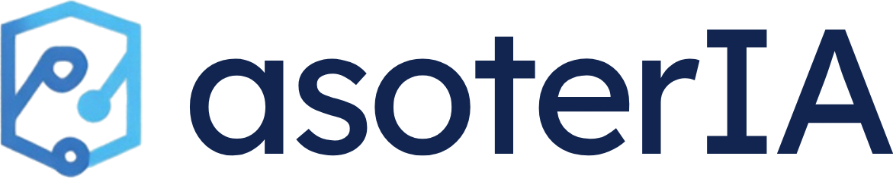

# asoterIA : IA locale et cloud privé pour cabinets d'avocats



Projet d'équipe pour le **Challenge Projets d'Entreprendre 2026 (27e édition, IMT Starter / IMT-BS / Télécom SudParis / ENSIIE)**, du lundi 2 au vendredi 6 novembre 2026, finale le lundi 9 novembre 2026.

> **En une phrase** : une box clé en main, installée et maintenue par nous, qui donne aux petits cabinets d'avocats un cloud privé et un assistant IA qui travaille sur leurs dossiers **sans qu'aucune donnée ne quitte le cabinet**.

Ce dépôt est la source de vérité du projet. Il est écrit pour être lu par les 5 membres de l'équipe **et par les agents IA** qu'ils utilisent. Un agent qui arrive sans contexte doit lire, dans l'ordre : ce README, puis [`AGENTS.md`](AGENTS.md), puis le document de `docs/` qui correspond à sa tâche.

Nom commercial du projet : **asoterIA** (choisi le 4 novembre, voir [Décisions ouvertes](#8-décisions-ouvertes)). Logo et usage : [`livrables/logo/`](livrables/logo/).

---

## Sommaire

1. [Le challenge en bref](#1-le-challenge-en-bref)
2. [Le projet](#2-le-projet)
3. [Pourquoi les avocats et le B2B](#3-pourquoi-les-avocats-et-le-b2b)
4. [Équipe et rôles](#4-équipe-et-rôles)
5. [Planning de la semaine](#5-planning-de-la-semaine)
6. [Roadmap à 5 ans](#6-roadmap-à-5-ans)
7. [Pièges à éviter](#7-pièges-à-éviter)
8. [Décisions ouvertes](#8-décisions-ouvertes)
9. [Organisation du dépôt](#9-organisation-du-dépôt)

---

## 1. Le challenge en bref

Détail complet : [`docs/attendus-challenge.md`](docs/attendus-challenge.md). PDF officiel : [`reference/les_attendus_du_challenge_2026.pdf`](reference/les_attendus_du_challenge_2026.pdf).

- **Livrable 1** : oral de **15 minutes + 7 à 10 minutes de questions** devant un jury prof/entrepreneur, le **vendredi 6 novembre** (bâtiment F, voir le planning des jurys). Slides + **prototype, démo ou mockup**. **Toute l'équipe doit parler.**
- **Livrable 2** : **executive summary de 2 pages** sur Moodle, **dépôt au plus tard le jeudi 5 novembre à 9h00**.
- **Finale** (si lauréats) : pitch de 3 minutes avec 2 ou 3 slides, **lundi 9 novembre à 18h**, Amphi 10, vote de la salle.
- **Présence obligatoire** en salle de coaching et aux ateliers. Une absence entraîne une sanction individuelle sur la note.

**Grille de notation (sur 20)**

| Critère | Points | Ce que le jury attend |
|---|---|---|
| Problème & marché | 4 | Preuves du problème, TAM/SAM/SOM, cibles, acteurs du marché, au moins 3 concurrents détaillés |
| **Solution / prototype** | **8** | Prototype ou mockup présenté, fonctionnement technique, roadmap technique avec temps et RH, état de l'art |
| Enjeux RSE | 2 | Impact **mesurable**, positif et négatif |
| Go to market & planning | 2 | Méthode de vente, coûts associés, hypothèses de clients justifiées, planning sur 3 à 5 ans |
| Finance & business model | 2 | Prix, projections justifiées, stratégie de financement. **Au moins 700 à 800K€ de CA à 5 ans** |
| Qualité de la présentation | 2 | Conviction, cohérence des supports, tout le monde parle |

Le jury a écrit noir sur blanc : **« Travail basique réalisé via IA = mauvaise note »**. Ce qui fait la différence : de vrais entretiens, des marques d'intérêt de professionnels, un prototype avancé.

---

## 2. Le projet

### Le problème

Les avocats manipulent des données couvertes par le secret professionnel. Ils voudraient utiliser l'IA générative (résumer un dossier, retrouver une pièce, rédiger un premier jet), mais envoyer les dossiers clients dans un service cloud grand public pose un problème de confidentialité. Les petits cabinets n'ont **pas de service informatique** pour monter une alternative locale.

**Ce problème est une hypothèse tant que les entretiens ne l'ont pas confirmé.** La preuve doit venir de vrais avocats, pas d'un agent IA.

### La cible

- **Cible** : les **cabinets d'avocats de 1 à 10 personnes**, sans service informatique, en commençant par l'Île-de-France. Vente en **B2B**.
- **Payeur ≠ utilisateur** : l'associé ou le fondateur du cabinet paie, les collaborateurs et assistants utilisent. Le pitch doit parler aux deux.
- **Extensions (vision à 5 ans uniquement)** : autres professions soumises au secret (experts-comptables, notaires, conseils en propriété industrielle), puis la santé. Elles servent au TAM et à la roadmap, jamais au persona ni à la démo.

Chiffres et sources : [`docs/marche-et-concurrence.md`](docs/marche-et-concurrence.md).

### La solution

Une box physique installée dans le cabinet, livrée configurée, avec :

- un **cloud privé** : fichiers, agenda, contacts, coffre-fort de mots de passe ;
- un **assistant IA local** qui répond en s'appuyant sur les documents du cabinet **et cite ses sources** (quel fichier, quelle page) ;
- un **pack métier** : par exemple, pour les avocats, les codes juridiques consultables hors ligne (données ouvertes à vérifier, voir [`docs/prototype.md`](docs/prototype.md)) ;
- **chiffrement** du disque, sauvegardes chiffrées, journal des accès visible par le client ;
- un **fonctionnement 100% hors ligne**. Toute connexion sortante (mises à jour, support, sauvegarde hors site) est **optionnelle, chiffrée et visible** dans le journal ;
- un **service** : installation sur place, mises à jour de sécurité, support en français.

**Notre valeur ajoutée n'est pas d'installer des logiciels libres.** C'est la couche maison : installeur en quelques clics, tableau de bord unifié, assistant IA qui croise les services en respectant les droits d'accès, pack métier, et le service humain autour.

### Le business model (hypothèses à valider)

Vente de la box + installation, puis **abonnement mensuel** (mises à jour, support, sauvegarde hors site chiffrée en option, mises à jour des modèles et du pack métier). Le revenu récurrent est indispensable : le matériel seul rapporte peu de marge. Détail : [`docs/business-model.md`](docs/business-model.md).

---

## 3. Pourquoi les avocats et le B2B

- **Une obligation légale, pas une préférence.** Le secret professionnel de l'avocat rend la confidentialité obligatoire. Le besoin d'une IA qui ne fait pas sortir les dossiers du cabinet est structurel.
- **Beaucoup de petites structures sans informatique.** La France compte 77 598 avocats inscrits ; 32% des cabinets n'ont qu'un avocat et 31% en ont 2 à 4 (sources S1 et S2 de [`docs/sources.md`](docs/sources.md)). Ces cabinets n'ont personne pour installer et maintenir une solution locale.
- **Un décideur identifiable qui peut payer.** L'associé décide et dispose d'un budget informatique : vente B2B, cycle de décision court.
- **Le B2B est plus crédible pour le jury.** Les organisateurs le disent : en B2C, il faudrait prouver une acquisition massive.
- **Un espace libre face aux concurrents.** Olares One, Umbrel, Start9 et ZimaCube vendent des box de cloud personnel à des passionnés ou au grand public. Aucun ne propose, à notre connaissance, un service clé en main sur place pour les cabinets d'avocats (**à confirmer** par la recherche sur la concurrence).

---

## 4. Équipe et rôles

5 personnes : **4 développeurs et 1 profil business & marketing**. Chacun travaille avec des agents IA. Les noms sont à compléter dans le tableau.

| Rôle | Nom | Responsabilités principales | Parle dans le pitch sur |
|---|---|---|---|
| **BIZ** Business & marketing | _à compléter_ | Pilote les entretiens, marché, concurrence, go to market, modèle financier, executive summary, fil narratif du pitch | Problème, marché, finance |
| **DEV-1** Plateforme | _à compléter_ | Matériel de démo, OS, conteneurs, installeur, mode hors ligne, sauvegardes | Go to market et planning (et architecture) |
| **DEV-2** IA | _à compléter_ | Modèle local, indexation des documents, réponses avec citations, pack métier | Fonctionnement de l'IA pendant la démo |
| **DEV-3** Interface & vitrine | _à compléter_ | Tableau de bord unifié, landing page + liste d'attente, captures et visuels des slides, vidéo de secours de la démo | Pilote la démo live |
| **DEV-4** Sécurité & mesures | _à compléter_ | Chiffrement, modèle de menace, accès distant optionnel, journal d'audit, mesure de consommation, roadmap technique et RH, cadre juridique technique, coûts techno pour le modèle financier | Sécurité, roadmap technique, RSE |

**Règles d'équipe**

- **Les développeurs passent aussi des appels.** Le profil BIZ ne peut pas faire seul tous les entretiens. Objectif : **chaque développeur passe au moins 3 appels le mardi et 2 le mercredi**.
- Toute information issue d'un entretien est consignée dans [`entretiens/suivi.md`](entretiens/suivi.md) par un humain.
- Un point d'équipe de 10 minutes à **12h00 et 17h30** chaque jour : ce qui est fait, ce qui bloque, ce qui change.

---

## 5. Planning de la semaine

Détail par rôle et par créneau : [`docs/planning-semaine.md`](docs/planning-semaine.md).

| Jour | Objectifs de fin de journée |
|---|---|
| **Mardi 3 nov** (aujourd'hui) | Atelier RSE à 13h30 (2 personnes : BIZ + DEV-4). **Liste de 40 cabinets d'avocats à appeler** et premiers appels. **Landing page + liste d'attente en ligne** le soir. Matériel de démo choisi, OS et services de base installés. Modèle IA local qui tourne. |
| **Mercredi 4 nov** | Atelier Finance & Pitch **avec toute l'équipe** (9h00 si équipe 1 à 47, 10h15 si équipe 48 à 94). **12h00 : persona validé à partir des premiers entretiens.** Démo de bout en bout fonctionnelle hors ligne. Modèle financier v1. **Executive summary terminé et déposé le soir** (pas le jeudi matin). |
| **Jeudi 5 nov** | **9h00 : date limite de l'executive summary sur Moodle.** Slides finalisées. **16h00 : gel de la démo** (plus aucune fonctionnalité). Vidéo de secours enregistrée. 3 répétitions chronométrées. Liste de questions du jury préparée. Open coaching facultatif (10h-17h, rue Étoile) pour un retour sur le pitch. |
| **Vendredi 6 nov** | **Jury** (bâtiment F, voir le planning). Arriver 30 minutes en avance, tester la démo sur place sans wifi. |
| **Lundi 9 nov** | Si lauréats : pitch de 3 minutes, 2 ou 3 slides, Amphi 10 à 18h. |
| **Avant le 15 nov** | Si l'équipe veut continuer : candidature individuelle au programme **Next Step** de l'ENSIIE (sIIEnext). |

---

## 6. Roadmap à 5 ans

Détail : [`docs/roadmap-5-ans.md`](docs/roadmap-5-ans.md). Tous les chiffres sont des **hypothèses** à justifier avant l'oral.

| Période | Produit et technique | Commercial | Équipe |
|---|---|---|---|
| **Année 0** (déc. 2026 à mi-2027) | MVP stable, 5 à 10 pilotes | Cabinets d'avocats pilotes en Île-de-France, incubation (Next Step, IMT Starter) | Fondateurs |
| **Année 1** | V1 commercialisée, pack métier avocats | Île-de-France, vente directe et partenariats avec les barreaux | 4 à 6 personnes |
| **Année 2** | Pack métier experts-comptables | Grandes villes françaises, intégrateurs informatiques locaux comme revendeurs | 8 à 10 |
| **Année 3** | Offre santé, via un partenaire certifié HDS pour la sauvegarde hors site | Toute la France | 12 à 15 |
| **Années 4 et 5** | Autres professions réglementées (notaires, conseils en propriété industrielle) | Belgique, Suisse, Luxembourg | 15 à 25 |

---

## 7. Pièges à éviter

Chaque piège ci-dessous a été identifié pendant l'analyse du projet. **Un agent ne doit jamais supprimer un piège de cette liste.** Il peut en ajouter.

### Cible et positionnement

1. **Diluer la cible.** Le persona, la démo et le SOM portent sur les **cabinets d'avocats**. « Toutes les professions libérales » serait trop flou. Les autres professions servent seulement au TAM et à la roadmap.
2. **Élargir pendant le challenge.** Experts-comptables, notaires, santé : uniquement dans la vision à 5 ans, jamais dans la démo ni dans le persona.
3. **Croire au « paradoxe de la vie privée ».** Les gens disent tenir à leur vie privée mais paient rarement pour. C'est pour ça qu'on vend en B2B à des professionnels soumis à une **obligation légale**, pas à des particuliers.
4. **Ignorer que le payeur n'est pas l'utilisateur.** L'associé décide et paie, les collaborateurs utilisent. Les entretiens doivent couvrir les deux.
5. **Laisser une gamme de prix floue.** Deux ou trois offres maximum, chacune liée à une taille de cabinet. Jamais une fourchette large et floue.

### Concurrence

6. **Ne pas citer Olares One.** Le jury le trouvera en 30 secondes. C'est le concurrent le plus proche (cloud personnel + IA locale sur les fichiers, 45 millions de dollars levés). On doit répondre clairement à « pourquoi vous et pas Olares ? » : service sur place en France, conformité au secret professionnel, pack métier, support en français, offre pensée pour un cabinet et pas pour un passionné.
7. **Oublier les concurrents gratuits ou indirects.** YunoHost (gratuit, français), Umbrel, Start9, ZimaCube, Synology, et les services d'IA en ligne (y compris spécialisés pour les avocats ou hébergés en Europe). **Au moins 3 concurrents détaillés** sont exigés : taille, fonctionnalités, stratégie, levées de fonds.
8. **Vendre comme un plus ce que les concurrents donnent gratuitement.** Start9 inclut le support à vie. Notre abonnement doit donc vendre autre chose : mises à jour de sécurité suivies, sauvegarde hors site, intervention sur place, mises à jour du pack métier et des modèles.

### Technique et sécurité

9. **Promettre « sans internet » et « support à distance » sans expliquer comment les deux cohabitent.** Règle : tout fonctionne hors ligne ; chaque connexion sortante est **optionnelle, chiffrée, déclenchée ou autorisée par le client, et visible** dans le journal.
10. **Oublier la sauvegarde hors site.** Si le cabinet brûle, la box et le coffre-fort brûlent avec. Règle 3-2-1 : une sauvegarde locale + une copie hors site **chiffrée côté client** (nous ne pouvons pas la lire).
11. **Sous-estimer la responsabilité.** Nous devenons responsables du coffre-fort et des dossiers d'un cabinet. Il faut expliquer qui applique les correctifs de sécurité, en combien de temps, et ce que dit le contrat.
12. **Donner à l'IA l'accès au coffre-fort de mots de passe.** L'assistant ne doit jamais lire le coffre. Il respecte les droits d'accès de l'utilisateur qui pose la question.
13. **Laisser l'IA répondre sans citer ses sources.** Pour un avocat, une réponse inventée est dangereuse. Chaque réponse doit indiquer le document utilisé.
14. **Surpromettre sur l'IA locale.** La qualité dépend du matériel. On annonce ce que la box de démo fait réellement, avec des temps de réponse mesurés.
15. **Une démo qui casse hors ligne.** Polices ou scripts chargés depuis un CDN, télémétrie, modèle non téléchargé à l'avance : tout cela échoue sans internet. **Tester la démo câble débranché dès le mercredi.**
16. **Utiliser de vraies données de clients ou d'entretiens dans la démo.** Les données de démo sont fictives et présentées comme telles.

### Juridique

17. **Le piège HDS pour la santé.** Un cabinet médical qui garde ses propres dossiers sur ses serveurs n'a pas besoin de la certification HDS. Mais si **nous** faisons la sauvegarde hors site ou l'administration à distance, nous risquons de devenir hébergeur et de devoir être certifiés (coût de l'ordre de 20 000 à 80 000€ sur 3 ans). D'où : santé en année 3, via un partenaire certifié.
18. **Ignorer les licences.** Nextcloud est sous licence AGPL (à vérifier pour chaque brique utilisée) : la revente commerciale est permise, avec des obligations sur le code source. Le dire au jury dans la partie « cadre juridique ».
19. **Passer du temps sur les statuts juridiques de la société.** Le jury le liste comme une erreur à éviter pendant la semaine.

### Marché, preuves et méthode

20. **Faire une étude de marché par questionnaire en ligne.** Le jury la considère comme une erreur. On fait de **vrais entretiens** (objectif : au moins 15 d'ici mercredi soir) et une étude macro sourcée.
21. **Présenter des chiffres sans source.** Chaque chiffre a une source dans [`docs/sources.md`](docs/sources.md), ou il est marqué **HYPOTHÈSE** avec son raisonnement.
22. **Laisser un agent IA inventer des entretiens, des citations, des clients ou des chiffres.** C'est le piège le plus grave : le jury pénalise le travail généré par IA, et un faux témoignage détruit la crédibilité de toute la présentation.
23. **Reprendre les prix des concurrents sans les revérifier.** Ils changent. Vérifier le jeudi avant de figer les slides.
24. **Présenter la pré-commercialisation de façon trompeuse.** « Fake it until you make it » veut dire une landing page et une liste d'attente pour mesurer l'intérêt, pas de faux clients ni de faux avis. On présente le produit comme un projet en cours.

### Pitch et livrables

25. **Déposer l'executive summary le jeudi matin.** La date limite est **jeudi 9h00**. Il doit être fini le **mercredi soir**.
26. **Décrire la solution sans la montrer.** Le jury le liste comme une erreur. La démo live est le cœur du pitch (8 points sur 20).
27. **Montrer des logiciels libres au lieu de notre couche.** Montrer Nextcloud, c'est montrer le travail des autres. On montre l'installeur, le tableau de bord, l'assistant qui croise les services et cite ses sources.
28. **Trop de briques en 15 minutes.** On ne montre que ce qui sert un cabinet d'avocats : documents, agenda, assistant, coffre-fort, sauvegarde, journal.
29. **Oublier qu'une seule personne parle.** Tout le monde doit s'exprimer : environ 3 minutes par personne.
30. **Dépasser les 15 minutes.** Répéter chronomètre en main au moins 3 fois le jeudi.
31. **Ne pas détailler les actions commerciales.** « Le produit ne se vendra pas seul » : canaux, coûts, nombre de clients visés et coût pour les acquérir.
32. **Un RSE déclaratif.** Mesurer la consommation réelle de la box au wattmètre, la convertir en kWh par an, et présenter honnêtement les impacts négatifs (fabrication, consommation continue).
33. **Viser moins de 700 à 800K€ de chiffre d'affaires à 5 ans.** C'est le minimum annoncé par le jury.
34. **Rater une session obligatoire.** Les absences au coaching ou aux ateliers entraînent des sanctions individuelles.

---

## 8. Décisions ouvertes

| Décision | Responsable | Échéance | Critère |
|---|---|---|---|
| Nom du projet | BIZ | Mardi 3 nov, 18h00 | Court, disponible en nom de domaine, pas déjà pris par un concurrent. **4 nov : « asoterIA » choisi**, logo fait sur Canva. À confirmer au point de 17h30. **Reste à vérifier** : nom de domaine libre, pas de marque déposée identique (base de l'INPI), pas de concurrent du même nom |
| Numéro d'équipe et salle de coaching | Toute l'équipe | Immédiat | À reporter dans [`docs/attendus-challenge.md`](docs/attendus-challenge.md) |
| Matériel de la démo | DEV-1 | Mardi 3 nov, 14h00 | Ce qui est disponible tout de suite et fait tourner un modèle local correct. **Proposition du 3 nov** : portable de DEV-1 (16 Go, sans GPU dédié), à remplacer par un mini-PC ou un portable avec GPU s'il y en a un d'ici mercredi midi. Détail dans [`docs/prototype.md`](docs/prototype.md), section 2. À confirmer au point de 17h30 |
| Prix des offres | BIZ + DEV-4 | Mercredi 4 nov, 17h30 | Coût matériel réel + réponses des entretiens |

---

## 9. Organisation du dépôt

```
README.md                    Ce fichier : point d'entrée
AGENTS.md                    Règles pour les agents IA
CLAUDE.md                    Charge AGENTS.md automatiquement dans Claude Code
docs/
  attendus-challenge.md      Règles, grille, calendrier officiel du challenge
  planning-semaine.md        Tâches par jour et par rôle (3 au 9 nov)
  marche-et-concurrence.md   Cible, TAM/SAM/SOM, concurrents, chiffres sourcés
  prototype.md               Spécification de la démo et architecture technique
  business-model.md          Offres, prix, modèle financier, financement
  rse.md                     Méthode de mesure de l'impact
  securite.md                Modèle de menace, chiffrement, journal d'audit, licences
  roadmap-5-ans.md           Planning global à 5 ans
  sources.md                 Toutes les sources citées
entretiens/
  guide-entretien.md         Script et questions
  modele-compte-rendu.md     Modèle de fiche d'entretien
  suivi.md                   Tableau de suivi des entretiens (données réelles uniquement)
livrables/
  logo/                      Logo asoterIA (PNG clair, sombre, icône), liens Canva
  executive-summary.md       Brouillon de l'executive summary (2 pages)
  plan-pitch.md              Déroulé des 15 minutes, qui parle quand
  questions-jury.md          Questions probables et éléments de réponse
prototype/                   Code de la démo (une partie par développeur, voir prototype/README.md)
  DEMARRAGE.md               Guide : lancer toute la box en une commande, choisir le modèle d'IA
  plateforme/                DEV-1 : box.sh, services Docker, installeur, sauvegarde, vérification hors ligne
  ia/                        DEV-2 : assistant IA (droits Nextcloud, citations, refus), mesures des modèles
  securite/                  DEV-4 : mesure de la consommation électrique
  donnees-demo/              Cabinet FICTIF de la démo : documents, agendas, contacts, droits
reference/                   PDF officiel du challenge
```
