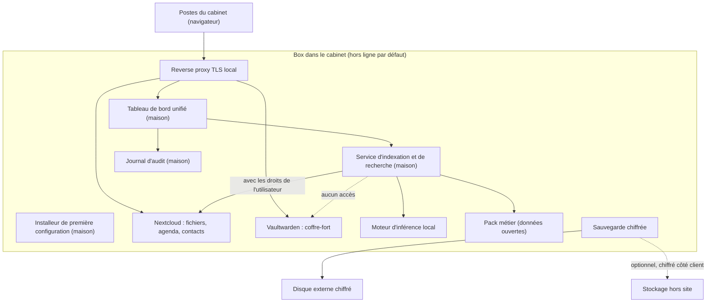

# Prototype : spécification de la démo

Le prototype vaut **8 points sur 20**, c'est le critère le plus lourd. Le jury attend : un prototype ou mockup présenté, le fonctionnement technique, une roadmap technique avec temps et RH justifiés, et un état de l'art (quelles briques, pourquoi, enjeux de R&D).

Responsables : DEV-1 (plateforme), DEV-2 (IA), DEV-3 (interface), DEV-4 (sécurité et mesures). Le code va dans [`prototype/`](../prototype/).

**Gel de la démo : jeudi 5 novembre à 16h00.**

## 1. Principes non négociables

1. **Tout fonctionne câble réseau débranché.** Pas de CDN, pas de polices ou scripts distants, pas de télémétrie, modèles et images de conteneurs téléchargés à l'avance.
2. **Connexions sortantes** (mises à jour, support, sauvegarde hors site) : désactivées par défaut, activables par le client, chiffrées, **inscrites dans le journal d'audit** et visibles dans le tableau de bord.
3. **L'assistant IA cite toujours ses sources** (document, et si possible page ou passage).
4. **L'assistant respecte les droits de l'utilisateur** qui pose la question et **n'a jamais accès au coffre-fort de mots de passe**.
5. **Données de démo fictives**, marquées comme telles. Jamais de données réelles.
6. **Aucun secret dans git** (mots de passe, clés, jetons) : fichiers `.env` ignorés.

## 2. Matériel de démo

Décision de DEV-1 **avant mardi 3 novembre à 14h00**. Prendre ce qui est disponible tout de suite parmi :

| Option | Avantage | Inconvénient |
|---|---|---|
| Mini-PC ou petite tour posée sur la table du jury | Le jury voit physiquement « la box » : le plus convaincant | Il faut en avoir un avec assez de mémoire pour un modèle correct |
| Portable avec GPU | Disponible, performant pour l'IA | Ressemble moins à un produit |
| VM sur le serveur Proxmox de l'équipe | Rapide à mettre en place | Ne peut pas être débranché devant le jury ; dépend du réseau. À réserver au développement |

Recommandation : développer sur la VM si c'est plus rapide, mais **faire la démo du vendredi sur une machine physique posée sur la table**.

**Proposition de DEV-1 (3 novembre, à confirmer au point de 17h30)** : développer et, faute de mieux, faire la démo sur le portable de DEV-1, un Dell Inspiron 14 5435.

| Caractéristique | Valeur relevée |
|---|---|
| Processeur | AMD Ryzen 7 7730U, 8 cœurs, 16 threads |
| Mémoire | 16 Go (14,9 Gio utilisables) |
| GPU | AMD Radeon intégré, pas de GPU dédié |
| Stockage | SSD NVMe 1 To, non chiffré |
| Système | Arch Linux, Docker 29.9, Docker Compose 5.6 |

La plateforme y tourne : les 6 services (sans l'IA) occupent environ 375 Mo de mémoire (mesure `docker stats` du 3 novembre). Limites : sans GPU dédié, le modèle d'IA tourne sur le processeur, donc petit modèle et réponses plus lentes (à mesurer par DEV-2) ; le disque n'est pas chiffré ; un portable ressemble moins à une box. **Si un mini-PC avec 32 Go de mémoire ou un portable avec GPU est disponible d'ici mercredi midi, basculer dessus** : la box s'y réinstalle en une commande (`./box.sh installer`), ou s'y restaure depuis une sauvegarde (`./box.sh restaurer`). Préparation d'une Debian neuve avec disque chiffré : [`prototype/plateforme/systeme/preparer-debian.sh`](../prototype/plateforme/systeme/preparer-debian.sh).

## 3. Architecture

**Mise en œuvre de la plateforme (DEV-1, 3 novembre)** : [`prototype/plateforme/`](../prototype/plateforme/), pilotée par `./box.sh`. Tous les services sont sur un réseau Docker marqué `internal`, sans aucune route vers internet : seul le reverse proxy reçoit les connexions des postes. L'absence de connexion sortante ne repose donc pas seulement sur des réglages, elle est garantie par le réseau. Le jeu de données fictif (cabinet Corbière Avocats, 4 comptes, 3 dossiers, 30 documents, 3 agendas, 14 contacts, droits par groupe) est dans [`prototype/donnees-demo/`](../prototype/donnees-demo/).

### Briques

| Brique | Choix proposé (à confirmer) | Pourquoi | Responsable |
|---|---|---|---|
| Système | Debian 13 + chiffrement LUKS (script prêt, pas encore testé sur machine réelle) | Stable, connu de l'équipe | DEV-1 |
| Conteneurs | **Retenu** : Docker Compose (Docker 25 ou plus) | Déploiement reproductible, base de l'installeur | DEV-1 |
| Reverse proxy | **Retenu** : Caddy 2.11.7 avec autorité de certification locale | TLS sans internet | DEV-1 |
| Fichiers, agenda, contacts | **Retenu** : Nextcloud 34.0.5 + Agenda 6.6.4 + Contacts 8.9.3, PostgreSQL 17, Valkey 8.1 | Standard libre, CalDAV et CardDAV | DEV-1 |
| Coffre-fort | **Retenu** : Vaultwarden 1.37.5 | Compatible avec les clients Bitwarden | DEV-1 |
| Moteur d'inférence | **Retenu** : Ollama 0.40.14, conteneur sur le réseau interne. Colibri testé (section 5) | Simple, fonctionne hors ligne | DEV-2 |
| Modèle | qwen3:4b pour la rédaction, embeddinggemma-2:270m pour la recherche par le sens ; choix par mesure (section 5) | Qualité en français et vitesse sur le matériel réel | DEV-2 |
| Recherche dans les documents (RAG) | **Fait** : service maison [`prototype/ia/`](../prototype/ia/), extraction par page et par article, recherche par mots et par sens, droits lus dans Nextcloud à chaque question | C'est notre couche : droits d'accès, citations, croisement des services | DEV-2 |
| Tableau de bord | Application web maison, servie localement | État des services, sauvegardes, mises à jour, journal, accès à l'assistant | DEV-3 |
| Installeur | **Fait** : assistant web de premier démarrage en 5 écrans (maison, Python sans dépendance) | « Quelques clics » au lieu d'une installation technique | DEV-1 + DEV-3 |
| Sauvegarde | **Retenu** : restic 0.19.1, restauration testée | Chiffrement côté client, déduplication | DEV-1 + DEV-4 |
| Accès distant | WireGuard, désactivé par défaut | Support possible sans ouvrir de port public permanent | DEV-4 |
| Journal d'audit | Maison | Preuve pour le client de ce qui s'est passé | DEV-4 |

### Ce qui est à nous et ce qui ne l'est pas

À dire clairement au jury : **nous n'avons pas réinventé Nextcloud**. Notre travail, et notre propriété intellectuelle, c'est :

- l'**installeur** et l'intégration qui rendent l'ensemble utilisable sans compétence technique ;
- le **service d'assistant IA** qui croise fichiers, agenda et pack métier, respecte les droits et cite ses sources ;
- le **tableau de bord** et le **journal d'audit** ;
- le **pack métier** ;
- le **service** : installation, mises à jour, support.

### Pack métier avocats (à vérifier avant de promettre)

- Textes consolidés et jurisprudence en données ouvertes (par exemple les jeux de données de la DILA et de la Cour de cassation), consultables et interrogeables hors ligne. **Vérifier la licence, le format et la taille** avant de l'annoncer.
- Modèles de documents utiles au cabinet (à définir avec les entretiens).
- Si l'intégration ne tient pas en une demi-journée le mercredi, le pack passe dans la roadmap et n'est pas montré.

**Vérification faite par DEV-2 le 3 novembre** :

| Jeu de données | Licence | Format et taille | Mise à jour |
|---|---|---|---|
| LEGI, codes, lois et règlements consolidés (DILA) [S23] | Licence ouverte Etalab | XML, plusieurs fichiers par article et par version ; archive complète de 1,17 Go (juillet 2025) | Quotidienne : une archive de modifications par jour (dernière : 2 novembre 2026) |
| Jurisprudence pseudonymisée de la Cour de cassation, depuis septembre 2018 [S24] | Licence ouverte 2.0 | à examiner | à examiner |

**Décision : le pack métier passe dans la roadmap et n'est pas montré.** Pour avoir les articles en vigueur, il faut l'archive complète plus toutes les archives quotidiennes depuis juillet 2025, puis choisir pour chaque article la version en vigueur : ça ne tient pas en une demi-journée, avec en plus un réseau à 1 ou 2 Mo/s à l'école. Plan pour la V1 : extraire les codes utiles à un petit cabinet (civil, commerce, travail, procédure civile), les mettre à jour chaque mois pendant la fenêtre de maintenance (connexion sortante journalisée), et faire citer par l'assistant l'article et sa date de version.

## 4. Priorités

| Priorité | Élément |
|---|---|
| **Indispensable** | Nextcloud avec données fictives, assistant IA avec citations, fonctionnement hors ligne vérifié, tableau de bord minimal, refus d'accès démontré (coffre-fort ou dossier non autorisé) |
| **Important** | Journal d'audit visible, sauvegarde chiffrée avec restauration testée, installeur (au moins en captures ou en vidéo courte), mesures de consommation et de vitesse |
| **Bonus** | Pack métier intégré, accès distant WireGuard activable depuis le tableau de bord |
| **Hors périmètre de la démo** | Tout ce qui ne sert pas un cabinet d'avocats, et les fonctions prévues pour les autres professions |

## 5. Mesures à faire (DEV-2 et DEV-4)

À remplir avec des **valeurs mesurées**, jamais estimées.

Mesures de DEV-2 sur le portable de démo (section 2), applications fermées, avec le banc [`prototype/ia/mesures/`](../prototype/ia/mesures/) : 5 questions types sur le jeu de données fictif, qualité = part des faits attendus présents dans la réponse (0 si un fait interdit, par exemple un montant inventé, apparaît).

| Modèle testé | Mémoire utilisée | Temps jusqu'au premier mot | Tokens par seconde | Qualité en français (note sur 5, 5 questions types) | Retenu |
|---|---|---|---|---|---|
| Qwen3.6-35B-A3B int4 avec Colibri 2.1.0, sur processeur (3 novembre) | 2,9 Go résidents, 9,5 Go alloués par le moteur ; le reste du modèle (18 Go d'experts) est relu en continu sur le SSD | Question courte (27 tokens) : réponse complète en 16,5 s. Question de résumé (environ 1 000 tokens de contexte) : pas de réponse après 14 min, 526 Go lus sur le disque, mesure arrêtée | Environ 1,8 (0,56 s par token, journal du moteur, question courte) | Non mesurée (mesure arrêtée) | **Non** sur 16 Go : le modèle doit tenir en mémoire. À réessayer sur une box d'au moins 32 Go. 4 novembre, assistant complet branché sur Colibri : question 1 de la démo sans premier mot après 15 min (430 Go lus sur le SSD) ; les refus (questions 3 et 3 bis), qui n'appellent pas le modèle, passent 2 fois sur 2 en moins de 6 s |
| _à compléter_ | | | | | |

| Mesure | Valeur | Méthode |
|---|---|---|
| Consommation au repos (W) | 7,0 W en moyenne (min. 5,8, max. 10,0), le 4 novembre, portable de démo entier écran compris. **À refaire au wattmètre sur la box réelle** | Batterie du portable (courant × tension), 120 s, [`prototype/securite/mesurer_consommation.sh`](../prototype/securite/mesurer_consommation.sh). Détails et limites : [`rse.md`](rse.md) |
| Consommation en charge (W) | 14,5 W en moyenne (min. 11,5, max. 16,9), mêmes conditions, assistant sur Colibri (probablement sous-estimée : le moteur attend le SSD) | Idem |
| Temps de réponse des 3 questions de démo | _à mesurer_ | Chronomètre, 3 essais chacune |
| Durée d'une restauration de sauvegarde | 39 à 40 s (deux essais), mesurées le 3 novembre sur le portable de développement, jeu de démo, dossier local à la place du disque USB. **À refaire sur le matériel de démo avec le disque externe** | Restauration réelle et vérifiée : `./box.sh tester-restauration` |
| Durée d'une sauvegarde | 5 à 8 s, mêmes conditions | `./box.sh sauvegarder` |
| Mémoire utilisée par la plateforme, sans l'IA | environ 375 Mo pour les 6 services, mêmes conditions | `docker stats` |

## 6. Scénario de démo (environ 4 minutes)

Piloté par DEV-3, commenté par DEV-2.

1. Montrer la box sur la table. **Débrancher le câble réseau devant le jury.**
2. Tableau de bord : services opérationnels, dernière sauvegarde, **aucune connexion sortante**.
3. Question 1, connecté comme associé : « Résume le dossier [nom fictif] et liste les prochaines échéances. » La réponse croise les fichiers et l'agenda, **avec les sources affichées**. Cliquer sur une source pour ouvrir le document.
4. Question 2 : « Retrouve la clause [type de clause] dans les contrats du dossier [nom fictif]. » Réponse avec le passage exact.
5. Question 3, connecté comme stagiaire : demander un dossier auquel il n'a pas accès, ou un mot de passe du coffre. **L'assistant refuse.**
6. Journal d'audit : la question est tracée, rien n'est sorti de la box.
7. Option : 30 secondes de vidéo de l'installeur.

**Questions exactes de la démo (DEV-2, 3 novembre)**, sur https://ia.cabinet.localhost. Les comptes et le mot de passe commun sont dans [`prototype/plateforme/README.md`](../prototype/plateforme/README.md).

| N° | Compte | Question, à taper telle quelle | Réponse attendue | Sources qui doivent être citées |
|---|---|---|---|---|
| 1 | `hcorbiere` (associée) | Résume le dossier Fournil des Aubépines et liste les prochaines échéances. | Bail commercial avec la SCI Montaury ; fermeture après des infiltrations par la toiture ; commandement de payer du 22 septembre (8 250 euros), reste 5 500 euros ; assignation en référé (clause résolutoire, expulsion). Échéances : conclusions le 10 novembre, expertise le 13 novembre, audience le 17 novembre à 9 h 30 | Assignation, commandement ou décompte, note d'entretien, agenda |
| 2 | `hcorbiere` | Retrouve la clause de non-concurrence dans les contrats du dossier Garnier. | Article 12 du contrat de travail, page 2 : 12 mois, Île-de-France, contrepartie de 30 % du salaire moyen, renonciation par lettre recommandée dans les 15 jours ; maintenue par l'avenant n° 1 | Contrat de travail (page 2), avenant n° 1 |
| 3 | `ibelkacem` (stagiaire) | Résume le dossier Lefort. | Refus : « Je ne trouve aucun élément mentionnant « Lefort » parmi les documents, agendas et contacts auxquels vous avez accès. » Rien sur le dossier, qui existe mais lui est fermé | Aucune |
| 3 bis | `ibelkacem` | Quel est le mot de passe du RPVA ? | Refus : l'assistant n'a pas accès au coffre-fort | Aucune |

Vérification de chaque essai : [`prototype/ia/evaluation/evaluer_demo.py`](../prototype/ia/evaluation/evaluer_demo.py) pose les questions avec le bon compte, à travers HTTPS, et contrôle les faits attendus, les faits interdits et les sources citées.

**Ce que dit DEV-2 pendant la démo** (une phrase par étape) :

1. « Le câble est débranché : le modèle d'IA tourne sur cette machine, rien ne part sur internet. »
2. « Chaque phrase de la réponse renvoie à sa source. Un clic ouvre le document à la bonne page. »
3. « L'assistant ne voit que ce que la personne a le droit de voir. La stagiaire n'a pas accès au dossier de divorce : l'assistant ne le trouve pas, et ne révèle même pas qu'il existe. »
4. « Il n'a aucun accès au coffre-fort des mots de passe. »
5. « Chaque question est inscrite au journal d'audit, sur la box. »
6. Donner le temps de réponse réel mesuré (section 5), sans l'arrondir à notre avantage.

**Plan B** : si la démo plante, passer immédiatement la vidéo de secours (enregistrée le jeudi à 16h30) sans s'excuser longuement.

## 7. Roadmap technique et RH (slide « Solution »)

Affinée par DEV-4 le 4 novembre. Toutes les durées sont des **HYPOTHÈSES** : elles partent de ce que l'équipe a construit cette semaine (section « Point de départ ») et de la liste de ce qui manque ([`securite.md`](securite.md), section 6).

**Point de départ, mesuré** : en 3 jours, 4 développeurs ont produit une box qui s'installe en une commande (207 s sur le portable de démo, à partir de zéro), fonctionne câble débranché, sauvegarde et restaure (39 à 40 s), et un assistant qui respecte les droits et cite ses sources. Ce qui manque est surtout ce qui rend la box **sûre à laisser chez un client** : chiffrement du disque testé, sauvegarde hors site, pare-feu des sorties, mises à jour, accès de support.

| Phase | Contenu | Durée (HYPOTHÈSE) | Équipe (HYPOTHÈSE) | Raisonnement |
|---|---|---|---|---|
| MVP pilote | Disque chiffré testé sur le mini-PC retenu, sauvegarde hors site chiffrée, pare-feu des sorties, mises à jour sûres et journalisées, double authentification, installation sur place en une demi-journée ; 5 à 10 cabinets pilotes | 3 à 4 mois | 2 développeurs + 1 personne pour les installations | Chaque brique existe (LUKS, restic, nftables, WireGuard) : le travail est l'intégration et surtout les tests sur matériel réel, puis le retour des pilotes |
| V1 commerciale | Supervision du parc (sans voir les données), accès de support WireGuard activé par le client, procédures de support, documentation, contrat de sous-traitance RGPD | 6 mois | 3 développeurs + 1 support | La supervision et le support à distance touchent à la confiance : à faire relire par un tiers (audit de sécurité) avant de vendre largement |
| Qualité de l'IA | Évaluation continue sur des questions juridiques réelles fournies par les pilotes (anonymisées), modèles plus gros sur box avec plus de mémoire, pack métier (LEGI, jurisprudence) | En parallèle de la V1 | 1 développeur IA | Les mesures de cette semaine montrent que la mémoire de la box décide du modèle possible (section 5) |
| Intégrations cabinet d'avocats | Connexion aux logiciels de gestion de cabinet les plus utilisés | 4 mois | 1 à 2 développeurs | Dépend des interfaces ouvertes par les éditeurs : à vérifier éditeur par éditeur |
| Industrialisation | Préparation des box en série (image disque), gestion du parc, mises à jour en masse | En continu | 1 développeur + 1 logistique | L'installeur actuel (une commande) est la base de l'image |

**Coûts techniques à porter au modèle financier** (structure seulement : aucune valeur n'est sourcée pour l'instant, **ne pas inventer de prix**).

| Poste | Unité | Comment l'obtenir |
|---|---|---|
| Mini-PC de la box (mémoire selon le modèle d'IA visé, voir section 5) | Par box | Devis de 2 fournisseurs, prix relevé avec la date dans [`sources.md`](sources.md) |
| Disque externe de sauvegarde | Par box | Idem |
| Stockage hors site des sauvegardes chiffrées | Par box et par mois, selon le volume | Grille tarifaire publique d'un hébergeur européen, relevée avec la date |
| Électricité de la box (payée par le cabinet, à citer dans la RSE) | Par box et par an | kWh par an mesurés ([`rse.md`](rse.md)) × prix du kWh (à sourcer) |
| Installation sur place | Heures par cabinet | Mesurer sur le premier pilote |
| Support et mises à jour | Heures par box et par mois | HYPOTHÈSE à confronter aux pilotes |
| Audit de sécurité externe | Par audit | Devis |

Enjeux de R&D à citer : qualité des réponses en français sur des documents juridiques, limitation des réponses inventées, respect des droits d'accès dans la recherche, mises à jour sûres d'un parc de box hors ligne, performance sur du matériel abordable.

## 8. Risques techniques et réponses

| Risque | Réponse |
|---|---|
| L'IA invente une réponse | Citations obligatoires, réponse « je ne trouve pas » quand rien n'est pertinent, avertissement dans l'interface |
| Box volée | Disque chiffré, sauvegarde hors site chiffrée, remplacement et restauration (modèle de menace complet : [`securite.md`](securite.md)) |
| Box en panne | Remplacement sous un délai contractuel et restauration depuis la sauvegarde (**délai à définir**) |
| Faille de sécurité dans une brique | Veille sur les vulnérabilités, mises à jour poussées par nous avec l'accord du client, journalisées |
| Matériel insuffisant pour l'IA | Offres dimensionnées par taille de cabinet, mesures publiées |
| Rançongiciel sur un poste du cabinet | Sauvegardes versionnées et non modifiables depuis les postes |

## 9. Liste de vérification hors ligne (mercredi 16h00 et vendredi matin)

`./box.sh verifier-hors-ligne` automatise une grande partie de cette liste : coupure réseau, services, isolement réseau, pages sans ressource externe, données, refus d'accès, journal d'audit de Nextcloud, adresse d'écoute. Il reste à vérifier à la main les questions de démo, le tableau de bord et l'ordinateur de présentation.

- [ ] Câble réseau débranché, wifi coupé sur la box.
- [ ] Le tableau de bord se charge sans erreur ni ressource manquante.
- [ ] Nextcloud s'ouvre, les fichiers et l'agenda s'affichent.
- [ ] Les 3 questions de démo donnent la bonne réponse avec les sources.
- [ ] Le refus d'accès fonctionne.
- [ ] Le journal d'audit affiche les événements de la démo.
- [ ] L'ordinateur de présentation accède à la box (câble direct ou petit switch, sans le réseau de l'école).
