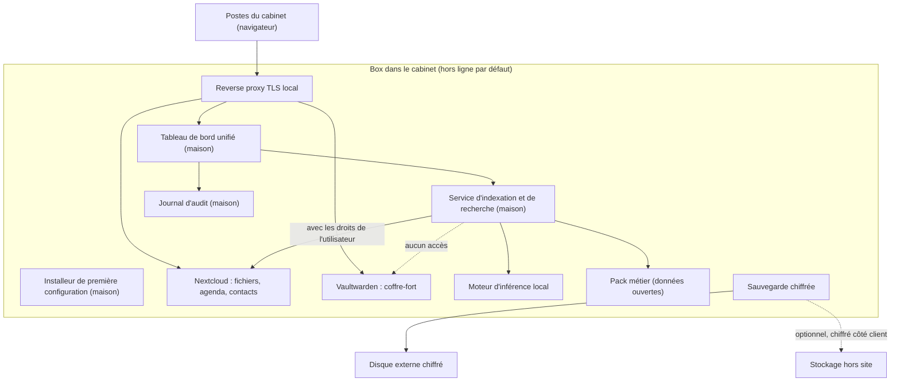

# Prototype : spécification de la démo

Le prototype vaut **8 points sur 20**, c'est le critère le plus lourd. Le jury attend : un prototype ou mockup présenté, le fonctionnement technique, une roadmap technique avec temps et RH justifiés, et un état de l'art (quelles briques, pourquoi, enjeux de R&D).

Responsables : DEV-1 (plateforme), DEV-2 (IA), DEV-3 (interface), DEV-4 (sécurité et mesures). Le code va dans [`prototype/`](../prototype/).

**Gel de la démo : jeudi 5 novembre à 16h00.**

## 1. Principes non négociables

1. **Tout fonctionne câble réseau débranché.** Pas de CDN, pas de polices ou scripts distants, pas de télémétrie, modèles et images de conteneurs téléchargés à l'avance.
2. **Connexions sortantes** (mises à jour, support, sauvegarde hors site) : désactivées par défaut, activables par le client, chiffrées, **inscrites dans le journal d'audit** et visibles dans le tableau de bord.
3. **L'assistant IA cite toujours ses sources** (document, et si possible page ou passage).
4. **L'assistant respecte les droits de l'utilisateur** qui pose la question et **n'a jamais accès au coffre-fort de mots de passe**.
5. **Données de démo fictives**, marquées comme telles. Jamais de données réelles.
6. **Aucun secret dans git** (mots de passe, clés, jetons) : fichiers `.env` ignorés.

## 2. Matériel de démo

Décision de DEV-1 **avant mardi 3 novembre à 14h00**. Prendre ce qui est disponible tout de suite parmi :

| Option | Avantage | Inconvénient |
|---|---|---|
| Mini-PC ou petite tour posée sur la table du jury | Le jury voit physiquement « la box » : le plus convaincant | Il faut en avoir un avec assez de mémoire pour un modèle correct |
| Portable avec GPU | Disponible, performant pour l'IA | Ressemble moins à un produit |
| VM sur le serveur Proxmox de l'équipe | Rapide à mettre en place | Ne peut pas être débranché devant le jury ; dépend du réseau. À réserver au développement |

Recommandation : développer sur la VM si c'est plus rapide, mais **faire la démo du vendredi sur une machine physique posée sur la table**.

Noter ici le matériel retenu et ses caractéristiques (processeur, mémoire, GPU, stockage) : **_à compléter par DEV-1_**.

## 3. Architecture

### Briques

| Brique | Choix proposé (à confirmer) | Pourquoi | Responsable |
|---|---|---|---|
| Système | Linux stable (par exemple Debian) + chiffrement du disque | Stable, connu de l'équipe | DEV-1 |
| Conteneurs | Docker Compose ou Podman | Déploiement reproductible, base de l'installeur | DEV-1 |
| Reverse proxy | Caddy (ou équivalent) avec autorité de certification locale | TLS sans internet | DEV-1 |
| Fichiers, agenda, contacts | Nextcloud | Standard libre, CalDAV et CardDAV | DEV-1 |
| Coffre-fort | Vaultwarden | Compatible avec les clients Bitwarden | DEV-1 |
| Moteur d'inférence | Ollama ou serveur llama.cpp | Simple, fonctionne hors ligne | DEV-2 |
| Modèle | Choisi par mesure (section 5) | Qualité en français et vitesse sur le matériel réel | DEV-2 |
| Recherche dans les documents (RAG) | Service maison : extraction de texte, embeddings locaux, base vectorielle locale | C'est notre couche : droits d'accès, citations, croisement des services | DEV-2 |
| Tableau de bord | Application web maison, servie localement | État des services, sauvegardes, mises à jour, journal, accès à l'assistant | DEV-3 |
| Installeur | Assistant web de premier démarrage (maison) | « Quelques clics » au lieu d'une installation technique | DEV-1 + DEV-3 |
| Sauvegarde | restic ou BorgBackup | Chiffrement côté client, déduplication | DEV-1 + DEV-4 |
| Accès distant | WireGuard, désactivé par défaut | Support possible sans ouvrir de port public permanent | DEV-4 |
| Journal d'audit | Maison | Preuve pour le client de ce qui s'est passé | DEV-4 |

### Ce qui est à nous et ce qui ne l'est pas

À dire clairement au jury : **nous n'avons pas réinventé Nextcloud**. Notre travail, et notre propriété intellectuelle, c'est :

- l'**installeur** et l'intégration qui rendent l'ensemble utilisable sans compétence technique ;
- le **service d'assistant IA** qui croise fichiers, agenda et pack métier, respecte les droits et cite ses sources ;
- le **tableau de bord** et le **journal d'audit** ;
- le **pack métier** ;
- le **service** : installation, mises à jour, support.

### Pack métier avocats (à vérifier avant de promettre)

- Textes consolidés et jurisprudence en données ouvertes (par exemple les jeux de données de la DILA et de la Cour de cassation), consultables et interrogeables hors ligne. **Vérifier la licence, le format et la taille** avant de l'annoncer.
- Modèles de documents utiles au cabinet (à définir avec les entretiens).
- Si l'intégration ne tient pas en une demi-journée le mercredi, le pack passe dans la roadmap et n'est pas montré.

## 4. Priorités

| Priorité | Élément |
|---|---|
| **Indispensable** | Nextcloud avec données fictives, assistant IA avec citations, fonctionnement hors ligne vérifié, tableau de bord minimal, refus d'accès démontré (coffre-fort ou dossier non autorisé) |
| **Important** | Journal d'audit visible, sauvegarde chiffrée avec restauration testée, installeur (au moins en captures ou en vidéo courte), mesures de consommation et de vitesse |
| **Bonus** | Pack métier intégré, accès distant WireGuard activable depuis le tableau de bord |
| **Hors périmètre de la démo** | Tout ce qui ne sert pas un cabinet d'avocats, et les fonctions prévues pour les autres professions |

## 5. Mesures à faire (DEV-2 et DEV-4)

À remplir avec des **valeurs mesurées**, jamais estimées.

| Modèle testé | Mémoire utilisée | Temps jusqu'au premier mot | Tokens par seconde | Qualité en français (note sur 5, 5 questions types) | Retenu |
|---|---|---|---|---|---|
| _à compléter_ | | | | | |
| _à compléter_ | | | | | |

| Mesure | Valeur | Méthode |
|---|---|---|
| Consommation au repos (W) | _à mesurer_ | Wattmètre, 5 minutes |
| Consommation en charge (W) | _à mesurer_ | Wattmètre, pendant 5 questions à l'assistant |
| Temps de réponse des 3 questions de démo | _à mesurer_ | Chronomètre, 3 essais chacune |
| Durée d'une restauration de sauvegarde | _à mesurer_ | Restauration réelle |

## 6. Scénario de démo (environ 4 minutes)

Piloté par DEV-3, commenté par DEV-2.

1. Montrer la box sur la table. **Débrancher le câble réseau devant le jury.**
2. Tableau de bord : services opérationnels, dernière sauvegarde, **aucune connexion sortante**.
3. Question 1, connecté comme associé : « Résume le dossier [nom fictif] et liste les prochaines échéances. » La réponse croise les fichiers et l'agenda, **avec les sources affichées**. Cliquer sur une source pour ouvrir le document.
4. Question 2 : « Retrouve la clause [type de clause] dans les contrats du dossier [nom fictif]. » Réponse avec le passage exact.
5. Question 3, connecté comme stagiaire : demander un dossier auquel il n'a pas accès, ou un mot de passe du coffre. **L'assistant refuse.**
6. Journal d'audit : la question est tracée, rien n'est sorti de la box.
7. Option : 30 secondes de vidéo de l'installeur.

Les 3 questions exactes et leurs réponses attendues sont écrites ici par DEV-2 le mercredi : **_à compléter_**.

**Plan B** : si la démo plante, passer immédiatement la vidéo de secours (enregistrée le jeudi à 16h30) sans s'excuser longuement.

## 7. Roadmap technique et RH (slide « Solution »)

Ébauche à affiner par DEV-4 le mercredi. Les durées sont des **HYPOTHÈSES** à justifier.

| Phase | Contenu | Durée | Équipe |
|---|---|---|---|
| MVP pilote | Stabilisation de la démo, installeur complet, mises à jour à distance sûres, 5 à 10 cabinets pilotes | 3 à 4 mois | 2 développeurs + 1 personne pour les installations |
| V1 commerciale | Supervision, sauvegarde hors site, documentation, procédures de support | 6 mois | 3 développeurs + 1 support |
| Intégrations cabinet d'avocats | Connexion aux logiciels de gestion de cabinet les plus utilisés | 4 mois | 1 à 2 développeurs |
| Industrialisation | Préparation des box en série, gestion du parc, mises à jour en masse | En continu | 1 développeur + 1 logistique |

Enjeux de R&D à citer : qualité des réponses en français sur des documents juridiques, limitation des réponses inventées, respect des droits d'accès dans la recherche, mises à jour sûres d'un parc de box hors ligne, performance sur du matériel abordable.

## 8. Risques techniques et réponses

| Risque | Réponse |
|---|---|
| L'IA invente une réponse | Citations obligatoires, réponse « je ne trouve pas » quand rien n'est pertinent, avertissement dans l'interface |
| Box volée | Disque chiffré, sauvegarde hors site chiffrée, remplacement et restauration |
| Box en panne | Remplacement sous un délai contractuel et restauration depuis la sauvegarde (**délai à définir**) |
| Faille de sécurité dans une brique | Veille sur les vulnérabilités, mises à jour poussées par nous avec l'accord du client, journalisées |
| Matériel insuffisant pour l'IA | Offres dimensionnées par taille de cabinet, mesures publiées |
| Rançongiciel sur un poste du cabinet | Sauvegardes versionnées et non modifiables depuis les postes |

## 9. Liste de vérification hors ligne (mercredi 16h00 et vendredi matin)

- [ ] Câble réseau débranché, wifi coupé sur la box.
- [ ] Le tableau de bord se charge sans erreur ni ressource manquante.
- [ ] Nextcloud s'ouvre, les fichiers et l'agenda s'affichent.
- [ ] Les 3 questions de démo donnent la bonne réponse avec les sources.
- [ ] Le refus d'accès fonctionne.
- [ ] Le journal d'audit affiche les événements de la démo.
- [ ] L'ordinateur de présentation accède à la box (câble direct ou petit switch, sans le réseau de l'école).
